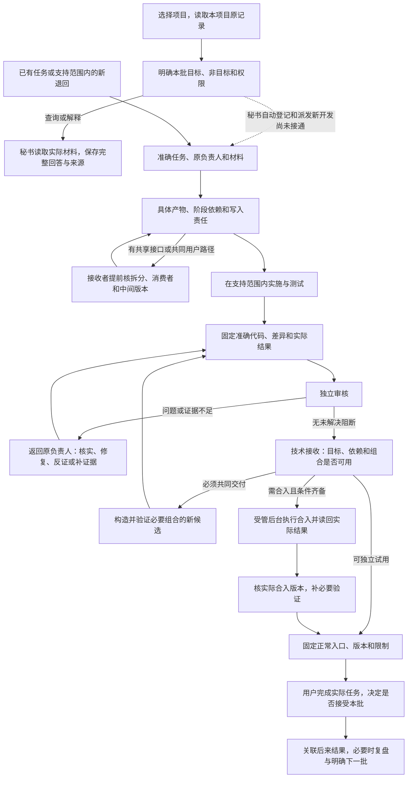
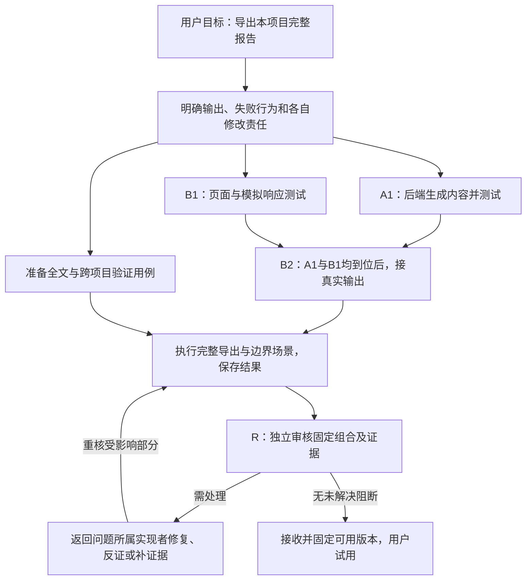
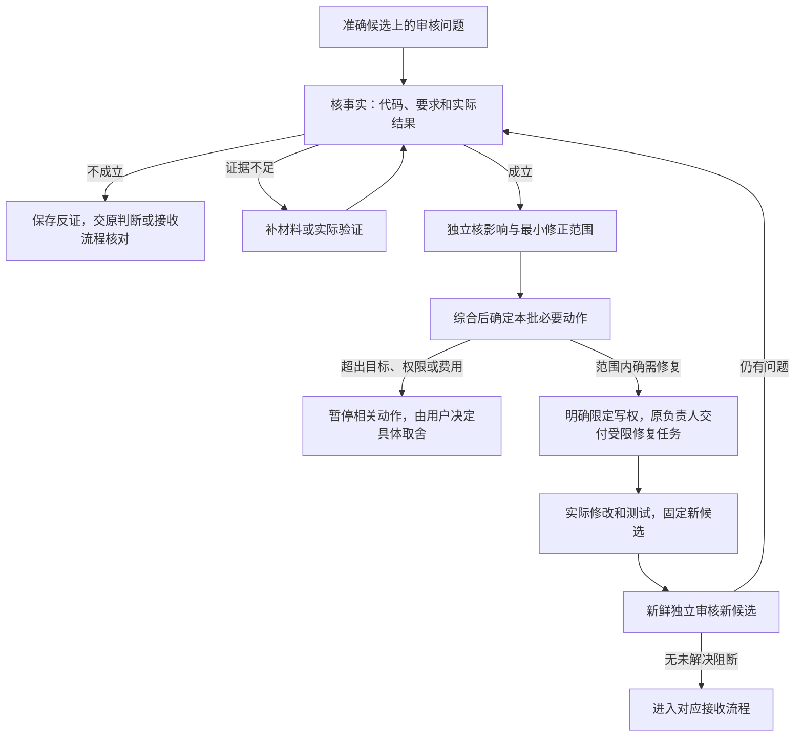

# 同序｜项目机制总览与检讨指南

**同序的目标是：你确定目标与边界，Agent在已有授权内协作，把结果交回正常入口；你减少找会话、搬报告和追进度的工作，同时仍能改变方向和停止投入。** 本文是理解和检讨整个项目的主入口。阅读者不需要从源码或各个PR反推流程；具体接口、限制与证据通过文中链接下钻。

2026-11-02 汇入关于完整流程、新任务接入、并行与阶段依赖、跨模型联系、在途执行、接收者提前介入及合并节奏的讨论；保留2026-10-31的具体任务例子。下面“报告导出”是说明机制的假设用例，不是新开发指令或已交付功能。本次整理不增加产品范围、审批层级、权限或验收通过声明。

### 本文与其他文档各管什么

| 记录 | 职责 | 使用时注意 |
| --- | --- | --- |
| 本文 PRODUCT_GUIDE.md | 面向使用者的机制总览、完整流程、当前边界和细节导航；逐节检讨的共同入口 | 总览不是新的授权或独立验收清单 |
| [tongxu_v2_plan.md](tongxu_v2_plan.md) | 产品设计与实施基线，保留目标、组织原则及原阶段安排 | 结合后来明确采用的决定阅读；其中历史“当前”不自动代表今天安装状态 |
| 本文第10节链接的专项文档 | 某个机制的输入、输出、约束、失败处理、入口与历史验证 | 历史候选和当时待办保留；不要只据旧段落重开事项或宣称完成 |
| [prompts/README.md](../prompts/README.md)及各角色提示 | 模型实际收到的职责和政策来源 | 提示词存在不证明角色已启动，也不能代替执行层工具限制 |
| 原Issue／PR、原运行和验收证据 | 决定出处、准确交付、失败、判断及后来的实际结果 | 文档、模型报告、合并和本人接受分别核实 |

本文中的**流程约定**说明应该怎样协作，**当前实现边界**说明已有入口能做到哪里，**验证记录**说明曾实际证明什么。三者不能互相替代。当前组合分支已有固定候选采集、隔离验证、原队列独立接收、受控修复与再审，以及读取真实任务和完整结果的[本机工作台](local_workbench.md)；各项能力不自动组成一条任意新项目的全自动开发链。

按[2026-10-23 用户确认的交付边界](https://github.com/wlvh/tongxu/issues/2#issuecomment-6356584442)，首条试用固定为：从正常入口选择已有任务和范围，查看原操作与完整结果，显式提问启动受限秘书，并在已配置权限内跟进。重复进入、停止和中断沿原输入/捕获处理；不让用户手工拼 JSON、挑内部脚本或搬报告。具体支持的版本、配置和必要验证以正常入口交付记录为准。只读试用不因全部52项或生产治理未齐而延期，也不冒称完整自动闭环。

当前余项唯一保存在本机 [completion-coverage.json](/Users/lyuhongwang/Desktop/tongxu/local-runs/autonomous-completion-20261020T052200Z/completion-coverage.json) 的 `currentRemainder`；本指南只展示流程，不再维护另一份待办。`firstTrial` 记录本次流程的必要证据、准确候选与不阻塞它的后续项；原52项、12项校正、固定旧审计和历史失败保留。正常安装与开发候选分别标明，达到声明范围即固定供试用，之后继续原 goal。正式本人采用、真实生产写权、合并和部署各需原依据；缺独立本人来源只限制依赖它的动作。本开发不操作 SEC_metrics，不增加认证或付费渠道。

已登记的退回任务可使用[原 A 处理入口](return_workbench.md)，查看固定候选、修改范围及原依据，再交给原修复/反证消费者处理。执行进度、完整原报告、新候选测试和独立判断均回到同一任务；未知状态保留，不能靠重开页面另起任务。原任务角色也可[按实际需要选择预登记联系项](task_contact_choice.md)，程序交给准确 B，再把完整回复送回原 A；没有联系需要就不启动 B。固定输入、完整捕获、候选及权限仍由原机制核验，模型报告不能增添收件人、命令或许可。

这两项可以和原任务、秘书问答装配在同一正常入口。现有真实联系结果和明确退回样例分别标识，读取和重开不会重发；本机准确安装以 `TRY_TONGXU.md` 和上述唯一映射为准。首条试用及原始证据保留，不把样例或历史报告回读称作新的生产采用，也不把原 A 的新上下文称作同一原生会话恢复。

### 阅读顺序

[1. 完整流程](#workflow) → [2. 角色、AI和记录对象](#roles) → [3. 新任务与并行协作](#coordination) → [4. 联系、跨模型和在途会话](#communication) → [5. 审核、接收与合并](#reception) → [6. 本人控制](#controls) → [7. 验收、追溯与偏移](#traceability) → [8. 失败与恢复](#recovery) → [9. 成功标准](#success) → [10. 完整细节索引](#documents)。

<a id="workflow"></a>

## 1. 从项目入口到实际成果

首页先回答：这一批要做什么、不做什么；现在有什么可以实际使用；哪些事情超出了已给的权限；你调整的安排是否生效；代理自行处置过哪些值得抽查的事。

五类控制是「本批目标」「组织方式」「委托与停止」「成果验收」「复盘与抽查」。正常项目模式先选择GitHub仓库，中央查看所选项目的Issues、PR、任务和报告，工作秘书常驻右侧。它们共用所选项目，不能把另一项目的任务或测试样例当作当前工作。入口和历史可按需展开，不要求你读完全部聊天或每个PR。

目标体验允许说话和直接操作共用后台。当前右侧秘书可以读取项目资料、解释进度、澄清目标；它没有通用创建开发任务、写代码、执行测试或合并工具。已配置的旧任务跟进和按钮按各自入口执行；不能将下面的完整产品流程说成右侧聊天已经全部接通。秘书不持有只有它知道的目标或权限，已装配的直接控制不依赖秘书在线。

下图的实线表示业务上的先后或反馈关系，**不表示所有箭头已经自动执行**。虚线明确标出新需求从秘书进入开发任务的连接边界；接收者提前参与只针对已有共享风险，不给每个独立小修增加审批。



只读查询本身可以完成一个用户目标，无需经过开发和合并。试用可以先固定在已验证分支；代码合入、功能启用、部署和本人接受分别记录。当前正常入口、构建、配置与原始证据以安装记录为准，流程图不改变它们。

对应细节：[项目入口](github_project_entry.md)、[项目秘书](project_secretary_chat.md)、[任务接入](task_intake.md)、[成果准备与执行](workbench_delivery_preparation.md)。

<a id="roles"></a>

## 2. 系统里谁负责什么

| 责任 | 要交付的结果 | 不应混淆的身份或能力 |
| --- | --- | --- |
| 你 | 确定用户目标、边界和必要授权，最后决定是否接受成果 | 技术通过、模型回复和别人代写的文字不能代替你的决定 |
| 工作秘书 | 从实际记录解释进度、问题和下一步，协助澄清并跟进 | 当前右侧项目对话以查询和解释为主，没有通用创建开发任务、写代码、跑测试或合并工具；旧任务秘书只有明确装配过的联系动作 |
| 技术负责人／实现者 | 把一个任务或一批成果做成，说明依赖，交付代码、测试与限制 | 任务负责人可以继续存在，而使用新的原生会话；换会话不自动换负责人，也不自动取得原现场写权 |
| 独立审核者 | 对准确候选及证据给出有范围的判断 | 用独立上下文检查；参与实现的原聊天不能同时冒称对自己改动的独立审核 |
| 事实与影响核实角色 | 核实问题是否成立、影响和修正范围，允许有依据的反证 | 不要求每个小任务都启动全部角色；报告不能自行增加写权 |
| 接收／集成角色 | 判断单个或组合候选能否进入目标，给出接收、退回或补证据结论 | 接收结论和实际合并、部署、用户接受分别记录 |
| 普通后台程序 | 定位准确对象，检查权限和依赖，转交完整材料，记录发送及实际结果 | 不用模型猜测已发送、已结束或已获授权；不从报告中执行新命令 |

文中A、B、R只代表这次分工中的执行者，不对应固定模型品牌。在后面的例子中，A负责后端，B负责页面，R负责独立审核；B写过页面，就不能用同一实现上下文给该页面作独立审核。每个角色可选的调用程序以当前已接入能力为准，不能因为检测到一个CLI就声称它能承担全部角色。

角色不是九个永久在线进程。一次简单修补无需走所有角色；整体复盘复用新鲜独立审核模式，不另开常驻“总审计师”。默认引擎是产品分工，不是模型优劣结论；实际版本、认证与费用在接入时验证，不保证CLI免费或任意订阅均可使用。

### 2.1 任务、负责人、执行与会话不是同一个对象

一个任务可经历多次执行、多个准确代码版本和模型会话。负责人表示谁对结果负责；一次操作表示实际处理了哪份输入；原生会话表示哪个CLI上下文收到问题。新会话可以延续原责任，但不能冒称恢复旧会话；换模型或目录也不能解除原写者的活动或未知占用。

候选就是“这次准备检查或交付的准确代码版本”，包括仓库、源提交、真实目标及基线。模型输入、测试、审核、接收都要对应它。处理同一项既有任务时，页面、秘书和CLI复用原任务、操作、输入和结果；页面显示是原记录的视图，不能另造一份状态作为批准依据。项目秘书的独立问答保留自己的对话归属，不伪装成已经登记的开发任务。

### 2.2 哪些工作需要模型，配置怎样生效

模型用于理解问题、解释资料、提出协调选择、核实与审核、修复决策和综合。项目筛选、定位原件、校验身份与权限、转交消息、防重复、执行登记测试及核对远端结果由普通程序完成；不让模型猜测这些动作有没有发生。

本机检测列出已有CLI、实际模型目录和推理选项；用户按项目和角色选择。保存设置不会启动模型，新运行固定本次实际选择，旧已发送请求和历史结果不追溯换绑。程序默认值必须显示来源，不能在没有具体任务时假装所有任务共用一个默认模型。

Node及其他外部程序按已声明最低要求和操作所需能力核验，不建立永久版本号或安装路径白名单。一次运行固定实际程序和输入摘要，是为了以后能查证当时用了什么，不等于长期锁死依赖。检测到程序、该角色支持程序、真实请求成功，是三件事。

当前项目秘书和受控工具路径仍有具体适配限制；新增CLI的无工具材料问答不等于专用协调、修复或原生控制都接通。可用组合查[本机AI与角色设置](local_ai_roles.md)，能力与升级规则查[cli_capabilities.md](cli_capabilities.md)和[runtime_compatibility.md](runtime_compatibility.md)。实际角色提示与工具边界查[prompts/README.md](../prompts/README.md)。

<a id="coordination"></a>

## 3. 从一个具体需求看任务怎么协作

假设你提出：「把当前项目的一份完整报告导出成Markdown，保留正文、来源和限制；不要导出别的项目，不做批量导出。」这是本文的说明用例。小改动若一个实现者更省事，就由一个人做；下面拆成两项是为解释确有必要时的协作，不要求为演示流程多开模型。

### 3.0 新任务加入，而原A已经在执行

假设A正在修改报告结构，B新加入做导出。流程约定是B先调查获准的代码与相关任务，再向A的任务提交联系请求；需要原负责人确认的内容，不能由另一个只看过快照的会话代答。具体投递能力见第4节。

| 阶段 | 需要核清什么 | 什么可以继续 |
| --- | --- | --- |
| 新任务调查 | 目标、已有任务、原A的责任、获准观察的未提交内容、接口变化 | B的独立调查；没有因此获得共享写权 |
| 共享约定 | 谁维护共享部分、准确输入输出、错误与来源含义、消费者、产物和验证 | 不依赖未决约定的工作 |
| 等待反馈 | 等谁对哪个当前版本作答，哪些回复仍未知 | 独立工作；未回复不算同意 |
| 前置到位 | 上游准确产物已取得并按本阶段要求使用，当前权限及写责任成立 | 受影响的依赖阶段 |
| 约定变化 | 哪些旧回复或证据不再适用，通知了谁 | 未受影响的部分；不要求全项目重来 |

新安排作用于尚未派发及后续受影响动作，不用一句组织调整强杀在途进程。受管写入在下一次动作前重新核阶段条件；若现场已变化，保存实际修改并等待核清。需要统一负责人时按第3.4节显式交接，不靠换目录、超时或删除占用绕过原执行。

对应细节：[设计基线第06—08节](tongxu_v2_plan.md)、[任务接入](task_intake.md)、[阶段协调](task_coordination.md)、[原实现者续做](managed_workspace_handoff.md)。

### 3.1 先确定本次真正要交付什么

完成结果是：用户在当前项目的报告页点击导出，得到与原报告正文、来源和限制相符的Markdown；权限不足或原件缺失时显示明确失败，不生成一份看似成功的空报告。只有“按钮画好了”或“后端函数测试通过”都还不是这个用户结果。

负责人先核已有代码、现有任务和未提交工作，再把本次输入、输出、错误处理和修改责任说清。例如约定：输入来自本项目的准确原报告；输出为UTF-8 Markdown；找不到原件、报告尚未完整、项目不匹配时如何返回失败；由谁维护这份约定。已有材料足够且范围未扩大时，这是团队内技术安排，不增加用户审批。

### 3.2 哪些具体工作可以并行

| 工作 | 谁负责、读取什么 | 实际产物 | 此时可以证明什么 |
| --- | --- | --- | --- |
| A1：报告内容生成 | 后端负责人A；读取原报告、已约定格式及错误行为 | 固定版本的导出实现，以及正文、中文换行、来源保留、原件缺失等测试结果 | 这版后端在其测试范围内正确，不代表页面已经接通 |
| B1：页面交互准备 | 页面负责人B；读取同一约定和现有页面 | 下载入口、等待／失败提示，以及使用明确模拟响应的页面测试 | 页面在该模拟条件下的表现，不代表已调用真实A1 |
| 验证用例准备 | 获准的验证者；读取用户要求和权限边界 | 检查全文一致、缺原件、跨项目拒绝等场景和预期 | 只完成了验证准备，尚未证明场景执行通过 |

在输入约定稳定、修改责任分开且执行权限成立时，这些工作可以同时推进。A与B不需要等对方所有工作结束。需要写代码时各自在获准工作区内修改，工作区和发布分支分别绑定准确责任；不同副本可以各自有写者，但共享接口、重叠改动和最终组合仍须核对。换目录不能绕过同一原任务的活跃或未知占用，文件名不同也不是语义上互不影响的证明。

只读调查也可以并行，例如A核对原报告的数据结构，B核对已有页面如何取得报告；这里没有因为“并行”就授予写入权。

一个反例：A在后端把“找不到报告”从明确错误改成空正文，B在另一个页面文件里仍把空正文当作成功下载。两人没有改同一文件，组合后的用户结果却错了。因此，路径分开和Git没有冲突都不能代替共享约定及真实组合验证。

### 3.3 阶段串行具体等什么

**B2：真实接入与组合测试**是B的下一项工作，它至少等待：

1. A1已交付准确版本、实现与所需测试证据，符合双方当前约定；不是只收到一句“A做好了”。
2. B1页面已准备好；B明确取到了本轮要接入的那版A1，程序已核对该阶段要求的材料使用记录，未拿旧代码或模拟结果替代。
3. 本次接入的权限、停止状态、工作区和写入责任仍成立。

齐备后，B用A1实际输出替换模拟响应，运行从“点击导出”到“得到文件”的组合检查，并保存实际结果。开始B2前的条件，与B2完成后的验收分开：B2开始前不能先声称真实导出已经验证。

等待期间，B可以继续整理与接口变化无关的页面文案或验证用例。A也可以继续非阻塞的文档整理；B2不必等待A整个Issue关闭、所有优化完成或A的PR已经合并到main。若A1接口、错误行为或原材料变了，只让受影响的接入和证据重新核对，不把旧通过直接沿用。



这说明同一功能里可以同时有并行准备和阶段串行。它们不是让整个项目三选一的永久模式，也不表示多开几个聊天就自动形成协作。准确阶段、产物和依赖由原任务计划表达；图中的箭头不会自行产生授权或执行。

### 3.4 什么时候更适合统一负责人

如果A和B反复同时修改同一套报告结构，每次改动都迫使对方重做，交接成本已经超过并行收益，可以明确让A顺序完成后端与页面。B已有的修改、暂存内容、运行和报告先保存并核清，活动或未知的原写者不能被强抢；写责任移交后才由A继续，R的独立审核仍保留。

同一个负责人顺序处理两项待办是“谁来做”的安排；B2等待A1是“哪个结果先到位”的依赖。换成同一负责人不会消除真实依赖，拆成两个Agent也不会自动使两项工作独立。角色对应的上下文、执行器和权限仍按实际记录处理。

### 3.5 当前程序支持到哪里

原协调机制能登记明确任务、负责人、共享部分、阶段依赖和固定产物；只读协调中，不同负责人的可执行工作可并发，同一负责人顺序处理。前置检查要求准确产物及相应使用记录，满足技术前置也不会自动给写权。工程修改仍走已有受限修复入口。

页面保存组织安排只是登记，实际投递发生在已有工作入口被启动后。当前专用多任务协调配置使用已接入的Codex／Claude入口；某个程序已支持任务负责人的材料问答，不表示专用协调、修复和原生会话控制都同时支持它。应按具体流程查能力，不能把设置页可选、安排已登记和模型已执行画成同一个状态。

它不会仅凭一句自然语言自动证明任务互不影响、推断全部依赖或为任意CLI配置任意工程环境。当前右侧秘书是查询和解释入口；已配置的原任务联系、组织安排和修复消费者各有明确范围。上述例子是工作机制说明，不是已完成一条“任意新项目从需求到自动合并”的实跑声明。

<a id="communication"></a>

## 4. 联系机制、不同模型与正在执行的会话

### 4.1 当前有限联系实际怎样完成

模型提出联系需要，普通后台按原任务记录投递和回读，不经过秘书逐句改写。仍以B向报告接口负责人A咨询为例：

1. 可信计划预先登记可联系的对象，每项固定准确任务、角色、程序、问题模板、材料和权限。
2. B读取材料，需要帮助时在完整最终回复中选择允许的联系人ID，并说明具体疑问；无需联系就交付自己的完整报告。
3. 后台核原捕获，将请求放入A对应任务的待办。实际发送前再核材料、原执行、停止、权限和费用；计划与报告不能自己扩大这些条件。
4. 后台将固定问题、B的完整原文及A必要的原任务材料交给已配置执行入口。收到完整回复后保存实际输入、准确会话、轮次及最终全文。
5. A的完整回复交回B的原任务综合；B说明实际采用了哪个版本、哪些结论或仍有哪些分歧。未完成的回复不推进后续阶段。

这条路径通过结构化报告表达有限联系选择，没有给模型任意发送、shell或自由创建收件人的工具。读取原报告、重新打开页面不重复发送；等待、拒绝、失败和已发未知均保留原记录。源码的A→B→A表示发起者→被联系者→发起者，与本例使用的字母顺序无关。

对应细节：[task_contact_choice.md](task_contact_choice.md)、[task_intake.md](task_intake.md)、[addressed_messages.md](addressed_messages.md)。

### 4.2 不同模型靠什么沟通

任务身份决定联系谁；适配器负责把统一消息转换成该CLI的输入，并核对其返回。模型品牌不作为收件地址。B用Codex、A用Claude时，后台保存B原文→送入Claude→保存A原文→交回Codex；各程序沿各自已有认证请求模型，不互换凭据或隐藏内部状态。

| 程序路径 | 同序如何提交输入与读取结果 | 能力边界 |
| --- | --- | --- |
| Codex | 通过本地App Server程序接口，向准确会话提交轮次并读回事件和最终回答 | 普通消息与受管持久会话控制分别配置 |
| Claude Code | 通过结构化输入输出流传消息，核会话、消息标识、回显和最终结果 | 不能把材料对话支持解释成任意在途写入会话控制 |
| Kimi、Gemini、OpenCode的已接入角色 | 通过ACP，即程序间交换会话、配置、输入和结果的协议 | 首批为受限无工具材料处理；检测、协议样例和真实调用分别记录 |

完整角色提示、可信任务输入和准确上游报告由程序装配；来自其他Agent的报告仍是证据，不能变成新命令或权限。材料超出支持范围时明确等待，不悄悄删掉全文。模型不同可以共享明确材料；同模型的两个独立会话也不会天然共享记忆。

更换程序或采用新上下文时，程序关联原任务与必要历史，如实记录是否恢复了原生会话。新会话看过A的代码或旧报告，不等于原A确认了未来接口。实际可用角色组合见[local_ai_roles.md](local_ai_roles.md)，提示装配见[prompts/README.md](../prompts/README.md)。

### 4.3 A正在执行时，联系会发生在哪里

**联系A的任务、恢复A的原会话、向A正在执行的轮次追加信息，是三种不同能力。**

| 原现场 | 当前入口的行为 |
| --- | --- |
| 原任务前项已完整结束 | 在原责任顺序中处理后续待办，带入必要历史；可能是新上下文，不能冒称原会话恢复 |
| 前项活动或未决 | 普通待办等待，不另开竞争执行来冒充原负责人回复；有界工作入口可在条件允许时消费后来加入的请求 |
| 程序拥有准确受管会话且已配置控制 | 专用入口可向准确当前轮次补充输入或发中断；回执与实际终态分别核对 |
| 用户自行在外部App／终端运行的会话 | 只读关联不授予投递或接管权；不能用“最近会话”或窗口名称猜地址 |

执行中补充输入称为steer。当前已接的这条专用控制路径受具体程序、角色与固定选项约束；普通联系请求没有自动变成发给原写入轮次的steer。这里没有任意Agent全天互相插话、自动发现所有在途写者的通用服务。准确能力见[owned_native_control.md](owned_native_control.md)与[session_association.md](session_association.md)。

已获准观察的未提交文件快照，只证明观察时那些字节是什么。它不能证明原A准备怎么改或同意B继续；原任务材料变化后还要核当前性。现有[真实联系记录](task_contact_choice.md)证明过Codex→Claude→Codex全文往返，返回原责任时是新上下文；同文档中的活跃写者测试使用模型夹具，证明未提交字节保留与共享阶段拒绝，不能代替“原A收到新问题并反馈后继续”的完整真实链。

### 4.4 什么变化需要通知，怎样确认没有漏传

接口、失败含义、来源、保存／复用、写责任、新依赖或实质反例变化时，通知受影响的相关人，绑定当前约定和准确材料。旧版本迟到回复保留为历史，不能放行新共享阶段；无关工作继续。持续通信表示变化后仍可可靠联系和接续，不要求固定每小时互报，也不要求模型常驻。

GitHub保存正式范围、交付、退回和验收；日常技术消息走原任务机制。评论已发布、消息已送达、完整回复已收到、下游实际使用分别记录。回复中的材料摘要只用于核对输入关联及声明，不证明模型理解正确；真正接入后的行为仍由结果和验证说明。

### 4.5 这种机制仍有哪些取舍

预登记对象和固定材料可以防止错投与越权，但不能靠它们掩盖用户需要幕后手工装配的缺口。对于已承诺的普通场景，应核查正常入口是否完成必要准备；不把“存在API／CLI模块”算作用户流程已接通。是否开放更动态的联系人发现和在途协调，应围绕明确场景与现有权限检讨，不由本文扩建通用通信框架。

<a id="reception"></a>

## 5. 审核、PR接收、共同交付与合并节奏

### 5.1 先区分审核、技术接收和实际合并

作者交代码与证据；独立审核查具体正确性；接收／集成角色判断是否符合本批目标、消费者和组合要求。实际合并由受管后台再次核当前版本、真实目标、必要检查和有效授权后执行并读回。秘书不能签技术通过或直接合并，模型建议也不是写入权限。

接收者在三个时点介入：共享接口、数据保存／复用或共同用户路径出现时，提前补查拆分和中间版本；候选形成后判断准确代码和证据；准备合入时核当前适用性。普通独立小修无需它事前签字。原流程图只在末端画接收者会漏掉第一种责任，故第1节明确保留早期反馈线。

对应细节：[receiver角色提示](../prompts/receiver.md)、[native_reception.md](native_reception.md)、[composite_reception.md](composite_reception.md)。

### 5.2 发现问题后的处理循环

审核发现先核事实和影响；成立的问题按归属返回原实现责任。在报告导出例子中，内容错误交A，页面交互错误交B，共享约定矛盾由负责人组织核清；审核者不会因此接管作者写权。



原A持续负责不等于永远使用同一进程；当前受控修复器由事实核实角色在限定写权成立后实施。工程修改使用获准工作区、文件和登记测试，测试判定器与运行控制器不由候选自行修改。无问题可以跳过修复，反证不制造空提交，旧失败保留；循环受已有范围、资源与停止条件限制。

完整链不能机械套在每个小改动上。各层应回答不同问题，复用仍适用的证据；缺证据先补证据，不默认多造模块或多开模型。当前受控工程修复不是任意项目、任意文件操作的通用开发器，具体支持集合和隔离要求见[project_repair.md](project_repair.md)。退回和反证接续见[return_workbench.md](return_workbench.md)、[review_records.md](review_records.md)及[member_refutation.md](member_refutation.md)。

### 5.3 多个PR什么时候需要共同合入

分别记录四种关系：开发需要什么材料／接口；合入前目标分支需要什么能力；功能启用还需要什么条件；几个任务属于哪个共同用户成果。资料依赖不自动变成分支依赖，同属一个成果也不自动把全部PR绑在一起。

| 情况 | 安排 |
| --- | --- |
| 各自可以安全工作和验证 | 各自满足条件后交付 |
| 消费者B依赖兼容基础A1 | A1可先合，B只等所需A1，不等整个A Issue |
| 多个部件最后才能对用户启用 | 兼容基础→消费者→启用，逐个中间版本保持所声明路径可用 |
| 任一单边合入会破坏现有路径 | 先核是否可以改成兼容拆分 |
| 仍无法安全拆分 | 明确必要成员，构造一个准确集成候选，验证及独立接收后一次目标更新 |

例如兼容接口A1→使用它的B1→接通入口A2，独立A3不被拖住。最小集成集合由明确选择和独立核实确定，程序不声称自动求出全仓库最优组合。每个成员单独通过不等于组合通过；成员修改后重核受影响组合。

两次快速合并仍有中间状态。一次代码目标更新也不自动意味着部署、迁移和功能开关同时生效。细节见[minimal_integration.md](minimal_integration.md)、[integration_member_repair.md](integration_member_repair.md)、[governed_recomposition.md](governed_recomposition.md)。

### 5.4 事件触发检查，条件决定合并，低频补查补漏

这三种机制不是三选一。新候选、审核返回、必要产物到位、目标或约定变化会触发相关检查；条件齐备且已有有效授权，才允许发送合入。低频补查用于发现遗漏与核原操作，无变化不反复唤醒模型，到点不全合。

```text
相关变化到来，或补查发现变化
→ 读取当前候选、依赖和原操作
→ 无实质变化：结束检查
→ 条件不足：记录具体等待原因，仅阻相关动作
→ 条件齐备且已有有效合并授权：登记请求、受管执行、读回实际结果
```

发送前核准确源提交和目标、原问题与必要审核／接收／组合证据、仓库规则、现行授权、停止与资源以及唯一目标责任。发送后读实际合入提交和目标树；失回执先查同一原请求。错误目标不能靠补测试追认，目标变化时不复制旧通过。

这是既有流程政策。有界事件补查入口不等于已经安装全天运行的服务；保存组织安排也不自动启动接收或合并。实际触发入口、支持范围和运行证据分别查[event_reconciliation.md](event_reconciliation.md)与[managed_merge.md](managed_merge.md)。可试用版本可以先固定在已验证分支，合并与本人接受不成为彼此的自动授权。

<a id="controls"></a>

## 6. 你日常怎样控制项目

「本批只做单公司，历史扩展放下一批」：锁定当前成果边界。新X2不会悄悄扩大X1。

「A、B共享改动串行，资料准备继续」：实施阶段受具体门约束，不停止所有工作。

「先别开新任务」：停止新实施，已有运行保留并按安全方式收尾；没有假装已杀掉所有进程。

「收回自动合并，但开发和验证继续」：阻止新合并请求；已发送或结果未知的请求继续核查。恢复新开发不自动恢复合并权限。

「这个扩展不值得，停止继续投入」：停止本批未开始部分，保留已经交付的代码、成果和证据。运行中的副作用需要核查，不自动回滚。

「给我能实际用的版本」：返回真实入口、示例产物、独立验证范围和限制，而不是只报测试数。

只读、逐次确认与有限委托都可使用。边界内正常技术选择不找你；改变目标、可接受失败、费用、权限或正式启用等才在后果发生前让你选择。秘书呈现各方依据、选项、成本／风险和受阻塞范围，不用自己的总结证明你批准了。

以上自然语言例子说明控制意图，不声称当前右侧聊天能直接执行全部控制。已接按钮与后端核相应本人来源；访问本机页面的钥匙不等于本人批准身份。既有订阅内限额、已确认的额外付费关闭及费用边界继续适用，不新增认证或付费渠道。一个身份或环境条件不足，只暂停依赖它的动作。

对应细节：[owner_authority.md](owner_authority.md)、[resource_claims.md](resource_claims.md)、[scope_controls.md](scope_controls.md)、[workbench_owner_workflows.md](workbench_owner_workflows.md)。

<a id="traceability"></a>

## 7. 怎样验收，以及怎样知道委托可靠

| 当你看到的说法 | 在报告导出例子里，具体需要什么 | 仍不能推出什么 |
| --- | --- | --- |
| 已收到／已回复 | 消息送到准确角色，或该角色已返回文字 | 文字不一定完整，也不证明代码已写、测试已跑 |
| 子任务完成 | A1交出准确版本和后端测试；B1交出页面与明确模拟条件下的结果 | 两份结果相加不自动证明真实下载可用 |
| 组合验证通过 | 固定A1与B页面实际组合，执行导出、全文比对和相应拒绝场景，保留输出 | 未覆盖环境、项目或输入仍有边界 |
| 技术审核通过 | R对准确候选、实际证据和已声明范围没有未解决阻断 | 不代替本人接受、合并权限或部署许可 |
| 可试用 | 固定可用版本、正常启动入口、支持范围和已知限制 | 不要求已合main，也不等于所有后续能力齐备 |
| 已合入 | 原目标分支确实包含准确合入结果并已读回核对 | 不自动表示功能已启用、部署或满足用户目标 |
| 本批成果已接受 | 你或有权来源对明确批次、场景和剩余限制作出接受决定 | 不自动扩大到下一批需求或未检查场景 |

只读查询本身也可以是一项完整成果：准确回答并保留来源即可，不必人为经过写代码、PR和合并。只有确需多任务共同交付时才使用上面的并行／串行安排；一次小修也无需把所有角色都启动一遍。

你在末端看真实用户路径、结果和限制，决定成果是否值得接受。重复检查、原件核对、领域验证可以委托独立执行者，不要求你亲手跑所有测试。技术合入、用户场景通过、入口启用、正式采纳和部署是不同状态。

工作台把一次重要判断与后来结果连起来：放行后有没有可复现漏检；finding是否被反证；某次升级其实是否在原授权内。记录候选、任务风险类型、模型／提示版本、实际观察范围和严重程度。没有报告缺陷不算准确，小样本不给精确可信率，不把不同难度任务做模型排行榜。表现好也不会自动扩权。

一批实际交付后、重复出现跨任务问题或你提出要求时，可以安排一次独立整体复盘。比较上一批已接受的目标和规则、累计变更、当前行为及文档，查重复抽象、分叉约定和范围偏移。只比较当前代码与当前文档不够，因为它们可能一起偏了。缺基线就说缺基线，不宣布没有漂移。

文档中，人的稳定边界、团队技术约定和事实说明各有变更权限：技术事实纠错不需要你每次“修宪”，但改文档也不能自动批准改变产品行为。

### 7.1 可追溯要检查每一次连接

一项结果应能查回：用户目标原出处→原任务→准确材料与代码版本→有效权限→实际执行者与输入→原始输出或修改→测试与审核→下游实际使用→用户结果。文件很多不等于这条关系成立。

| 需要回答的问题 | 核对依据 |
| --- | --- |
| 谁要求了这件事，范围是什么 | 用户决定或有效委托原文，以及该任务采用的范围 |
| 谁实际做了什么 | 原操作、程序身份、准确会话／轮次、实际输入与原始捕获 |
| 下游拿到哪一版 | 固定材料与完整报告、发送回执及当前适用性 |
| 是否真正用于后续工作 | 原后续输入、具体结果、接入或测试证据；材料摘要回执不能单独证明理解正确 |
| 受测与交付是否一致 | 测试对应的候选和文件树、最终交付或合入的实际对象 |
| 这批是否被接受 | 对准确批次、场景、证据和剩余限制的有权决定 |

历史接收判断、旧材料今天是否仍适用、代码今天是否通过其他路径交付，是不同事实。旧包“适用性待核”不能直接解释成当前开发没有完成；新合入也不能改写当时的证据不足。秘书应读取完整原报告和正式收尾来源后，用清楚语言分别解释，操作编号和摘要作为可查证依据。详见[secretary_original_reports.md](secretary_original_reports.md)。

### 7.2 怎样检讨是否偏离原意

意图漂移（drift）就是实现和安排逐渐偏离原来要解决的问题。检讨时对照四件事：原先有效的目标与边界、当前文档约定、实际程序行为、真实结果。代码与今天的文档一致仍不够，因为二者可能一起偏了。

逐节先确认用户结果，再核责任、输入、输出和开始／结束条件，然后查真实连接与失败路径。区分必要约束、实现缺口、已授权演进、历史文字落后和仅为方便而提出的建议；不要把“更严格”自动当作“更符合目标”。

当前尤其需要避免把下列差别抹平：秘书能解释不等于会派发开发；有任务联系不等于已联系原在途写者；协调前置成立不等于获准修改；多层审核不等于每层都有新增价值。这些是本文的检讨视角，具体已确认缺陷仍回原唯一余项记录，不在这里另开清单。

对应细节：[delivery_outcomes.md](delivery_outcomes.md)、[delivery_assessment.md](delivery_assessment.md)、[workbench_judgment_feedback.md](workbench_judgment_feedback.md)、[workbench_baseline_preparation.md](workbench_baseline_preparation.md)。

<a id="recovery"></a>

## 8. 出问题时怎么继续

会话断线、投递或合并无回执，先查原对象，不重新派发或重复副作用。界面显示未知、待核、已发生，不把请求当成功。实际合入与受测内容不一致，保留已合入事实并补实际版本证据，不自动回滚；错误目标不能靠补测试追认。

失败要给出能继续的具体条件。例如：A1原件缺失时补回准确原件，不要求重做页面；导出内容错误时修复A1并复核受影响组合；运行是否结束未知时查原进程、日志和已发生修改，不另开同任务替身。确认原执行结束、现场已核清且权限仍有效后，可以按原操作恢复或明确准备后继，不把等待变成永久禁止。新原生上下文必须如实记录；旧失败和已完成结果都保留。

| 原现场 | 应如何继续 |
| --- | --- |
| 已确认没有发送 | 按原记录继续准备，或明确关闭未发送请求；不悄悄换问题或候选 |
| 原执行仍活动 | 读进度、等待或用准确受支持的停止入口，不多开竞争执行 |
| 是否已执行未知 | 核原进程、日志、容器或远端副作用，不凭超时或换ID重发 |
| 已结束且完整结果存在 | 从原捕获补回结果及尚未完成的消费，不再调用模型制造“恢复” |
| 已结束但只有部分修改／回答 | 保存现场，核清后按原授权接续或明确准备后继，不把部分结果当成功 |

关闭浏览器、关闭本机服务、停止一轮模型、停止新实施、收回合并和停止新增投入，是不同动作。浏览器刷新或切项目不取消已发执行；项目秘书的本机入口关闭会收尾其拥有的问答，受管修复短期进程有自己的寿命，不能笼统承诺随网页关闭而结束。已经发出的远端请求先核事实；不具备原生控制时不能画成有效停止按钮。本地主机关机不承诺持续运行。

已发送问题与结果按原机制保存；尚未发送的秘书草稿只有页面会话内的保存边界，刷新或关闭前需要保留自己的未发送文字。完整报告可重读，新上下文、原会话恢复及重发必须分别记录。详细寿命和恢复入口见[project_secretary_chat.md](project_secretary_chat.md)、[return_workbench.md](return_workbench.md)、[owned_native_control.md](owned_native_control.md)、[managed_workspace_handoff.md](managed_workspace_handoff.md)。

<a id="success"></a>

## 9. 什么才算同序成功

不是Agent更多、消息更顺畅，而是人少作机械决定，方向控制仍有效；已知问题更早被工具发现，必要判断有明确责任，交付等待减少，严重遗漏没有增多，维护同序没有吞掉节省。

当前本机工作台可在可访问的GitHub仓库间切换，每次查看和动作都绑定准确项目；单用户本机试用不等于已经支持跨仓库共同写入或任意主机部署。原离线HTML原型使用虚构数据演练，当前页面读取明确配置的原记录，两者应区分。

一次有价值的试用应证明：用户从正常入口启动支持范围内的工作，能看实际进度与完整结果；重开后不需要复述整件事、不重复发送；原本需要搬报告或追问的负担确实减少。必须由开发者在幕后逐次拼JSON、补跑隐藏步骤才能走完已承诺场景时，应如实记软件缺口，不能统称外部条件。

固定可用版本不要求后续所有能力齐备，也不等于全部52项或正式生产采用完成。新的非必要泛化不自动抬高已声明交付门槛；破坏已承诺流程的缺陷继续处理。后续目标与前一批成果分开记录，见[scope_followup.md](scope_followup.md)。

<a id="documents"></a>

## 10. 完整机制的细节文档索引

这是现有文档的阅读入口，不是新的任务清单或完成率表。历史实施文档中的旧候选和“当时待做”保留为历史；当前实际交付仍查正常安装和唯一余项，不能仅凭某一段旧文字重开任务或宣布完成。

### 10.1 入口、项目、AI与原始材料

| 具体问题 | 完整文档链接 |
| --- | --- |
| GitHub身份、仓库选择、项目隔离和分页 | [github_project_entry.md](github_project_entry.md) |
| 正常工作台、原队列读取及配置 | [local_workbench.md](local_workbench.md)、[local_reception_integration.md](local_reception_integration.md) |
| 常驻项目秘书、追问、全文和关闭语义 | [project_secretary_chat.md](project_secretary_chat.md) |
| 原任务秘书、完整历史报告与正式收尾 | [readonly_secretary.md](readonly_secretary.md)、[secretary_original_reports.md](secretary_original_reports.md) |
| 本机AI发现、模型和强度选择、实际角色支持 | [local_ai_roles.md](local_ai_roles.md) |
| 外部程序最低要求、能力探测和升级 | [runtime_compatibility.md](runtime_compatibility.md)、[cli_capabilities.md](cli_capabilities.md)、[w4_native_inspection.md](w4_native_inspection.md) |
| 固定候选采集、当前目标观察及原件 | [w1_cli.md](w1_cli.md)、[source_currentness.md](source_currentness.md) |
| 原工具验证、准确受测树和Docker路线 | [w2_verification.md](w2_verification.md)、[docker_verification.md](docker_verification.md) |
| 原结果导入、追加、回放与交接输入 | [codex_result_adapter.md](codex_result_adapter.md) |

### 10.2 任务、消息、责任与审核修复

| 具体问题 | 完整文档链接 |
| --- | --- |
| 无PR任务登记、负责人待办、后来形成PR | [task_intake.md](task_intake.md)、[task_candidate_link.md](task_candidate_link.md) |
| 新任务、共享约定、阶段依赖和实际产物 | [task_coordination.md](task_coordination.md) |
| 工作台读取协作、任务联系与实际控制 | [coordination_workbench.md](coordination_workbench.md)、[task_controls.md](task_controls.md) |
| 模型选择预登记联系人、完整往返 | [task_contact_choice.md](task_contact_choice.md) |
| 跨程序消息、准确会话与完成回执 | [addressed_messages.md](addressed_messages.md) |
| 只读会话关联、受管续接与执行中控制 | [session_association.md](session_association.md)、[owned_native_control.md](owned_native_control.md) |
| 前序已完成、仅最后消息未发的接续 | [message_resource_handoff.md](message_resource_handoff.md) |
| A持续实现、保存现场、最小显式交接 | [managed_workspace_handoff.md](managed_workspace_handoff.md) |
| 最初只读审核、影响核实和综合链 | [local_readonly_relay.md](local_readonly_relay.md) |
| 受控修复示例与已有工程的实际修复 | [controlled_repair.md](controlled_repair.md)、[project_repair.md](project_repair.md) |
| 原退回、修复／反证、再审与判断反馈 | [review_records.md](review_records.md)、[return_workbench.md](return_workbench.md) |

### 10.3 接收、组合、事件、发布与合入

| 具体问题 | 完整文档链接 |
| --- | --- |
| 原接收队列、依赖、占用及影子评估 | [w3_shadow_queue.md](w3_shadow_queue.md) |
| 单候选独立接收及已有授权接入 | [native_reception.md](native_reception.md)、[governed_reception.md](governed_reception.md) |
| 双任务材料准备与接收阶段串行 | [paired_reception.md](paired_reception.md) |
| 固定多成员组合的接收身份和范围 | [composite_reception.md](composite_reception.md) |
| 证据不足后的补充、矛盾输出的后续处理 | [reception_supplement.md](reception_supplement.md)、[receiver_correction.md](receiver_correction.md) |
| 必要集成候选、成员修复和重新组合 | [minimal_integration.md](minimal_integration.md)、[integration_member_repair.md](integration_member_repair.md) |
| 已结束部分构造的接续 | [integration_continuation.md](integration_continuation.md) |
| 新组合测试的授权与已知失败后重试 | [governed_recomposition.md](governed_recomposition.md)、[recomposition_retry.md](recomposition_retry.md) |
| 问题反证后的新接收与准确许可 | [member_refutation.md](member_refutation.md)、[refutation_authority.md](refutation_authority.md) |
| 私有候选与已有远端PR的真实关联 | [observed_candidate.md](observed_candidate.md) |
| 事件补查、去重和候选选择 | [event_reconciliation.md](event_reconciliation.md) |
| 结果发布、授权、读回与正式退回通知 | [result_publication.md](result_publication.md)、[governed_publication.md](governed_publication.md)、[publication_return.md](publication_return.md) |
| 合并前提、单次目标更新及未知结果恢复 | [managed_merge.md](managed_merge.md) |

### 10.4 人的控制、成果与偏移检讨

| 具体问题 | 完整文档链接 |
| --- | --- |
| 本人来源、有限委托与撤销 | [owner_authority.md](owner_authority.md) |
| 原资源认领、结算与未知状态 | [resource_claims.md](resource_claims.md) |
| 停止实施、合并和新增投入 | [scope_controls.md](scope_controls.md) |
| 组织方式及按需复盘的页面连接 | [workbench_owner_workflows.md](workbench_owner_workflows.md) |
| 固定成果批次、实际场景和接受决定 | [delivery_outcomes.md](delivery_outcomes.md)、[delivery_assessment.md](delivery_assessment.md) |
| 从页面准备、启动与回读成果验证 | [workbench_delivery_preparation.md](workbench_delivery_preparation.md) |
| 判断之后的观察与接受基线 | [workbench_judgment_feedback.md](workbench_judgment_feedback.md)、[workbench_baseline_preparation.md](workbench_baseline_preparation.md) |
| 明确新目标后的原负责人接续 | [scope_followup.md](scope_followup.md) |

### 10.5 提示词、原要求与历史出处

模型输入装配说明见[prompts/README.md](../prompts/README.md)，公共边界见[runtime_contract.md](../prompts/runtime_contract.md)和[tool_policy.json](../prompts/tool_policy.json)。各角色分别为[secretary.md](../prompts/secretary.md)、[issue_owner.md](../prompts/issue_owner.md)、[implementer.md](../prompts/implementer.md)、[reviewer.md](../prompts/reviewer.md)、[verifier_fact.md](../prompts/verifier_fact.md)、[verifier_impact.md](../prompts/verifier_impact.md)、[receiver.md](../prompts/receiver.md)、[acceptance.md](../prompts/acceptance.md)、[external_report.md](../prompts/external_report.md)。模板不等于已接通独立启动器；固定上游来源见[prompts/upstream/manifest.json](../prompts/upstream/manifest.json)。

原52项验收保持在[T01—T32](acceptance/T01-T32.json)、[T33—T44](acceptance/T33-T44.json)、[T45—T52](acceptance/T45-T52.json)，工作包映射在[work_packages_W0-W7.json](acceptance/work_packages_W0-W7.json)。它们的原始未执行标记不替代今天的唯一余项和准确证据。

原阶段条款依次为[W0](issues/01_W0_baseline.md)、[W1](issues/02_W1_facts_and_pr_handoff.md)、[W2](issues/03_W2_evidence_and_combination.md)、[W3](issues/04_W3_queue_authorization_operations.md)、[W4](issues/05_W4_executor_adapters.md)、[W5](issues/06_W5_review_loop_relay.md)、[W6](issues/07_W6_dispatch_and_delivery.md)、[W7](issues/08_W7_three_views_and_release.md)。历史设计与审核见[archive/](archive/)、[review/](review/)、[design-history/](design-history/)；原验证说明见[verification/README.md](../verification/README.md)，不能把原型验证当成当前产品采用。

历史本机接续材料见[local_codex_handoff.md](local_codex_handoff.md)及[local_claude_verification.md](local_claude_verification.md)，持续开发交接见[CODEX_NEXT.md](CODEX_NEXT.md)。这些是来源或维护指引，正常使用应从当前安装入口开始，不要求用户照旧迁移步骤重建环境。
