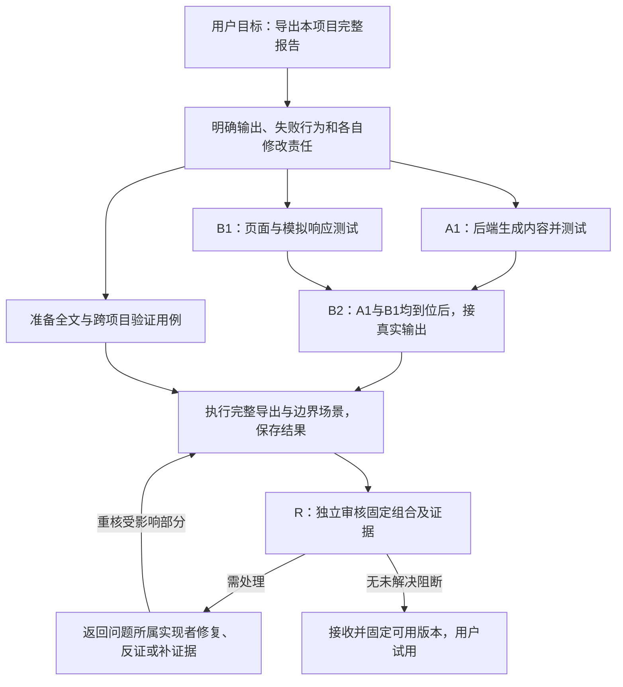

# 同序｜工作机制与使用说明

**你掌握目标、组织方式和委托边界；工作秘书负责安排与跟进；技术Agent完成开发、审核和交付。** 本文后续章节描述完整产品要求，不是每项已通过的验收声明。当前组合开发分支已提供固定候选采集、隔离验证、原生接收与发布回读、受控修复与再审，以及读取真实任务和完整结果的[本机工作台](local_workbench.md)。[工作秘书的受限调用](readonly_secretary.md)、[原负责人接续和原生会话控制](owned_native_control.md)、[本人控制与组织/复盘](workbench_owner_workflows.md)、成果验证和基线准备也已有对应实现与分项证据。原始失败、限定样例与真实模型记录分别保留，不能相互替代。

2026-10-31 的这次修订把抽象角色和阶段改成可以对照的任务、产物、开始条件和失败处理，不增加产品范围、审批环节或调度机制。下面“报告导出”是解释协作的假设用例，不是新开发指令，也不是已经交付的功能。实际可用程序、角色及工具见 [local_ai_roles.md](local_ai_roles.md)；实际安装与余项仍以原记录为准。

按[2026-10-23 用户确认的交付边界](https://github.com/wlvh/tongxu/issues/2#issuecomment-6356584442)，首条试用固定为：从正常入口选择已有任务和范围，查看原操作与完整结果，显式提问启动受限秘书，并在已配置权限内跟进。重复进入、停止和中断沿原输入/捕获处理；不让用户手工拼 JSON、挑内部脚本或搬报告。具体支持的版本、配置和必要验证以正常入口交付记录为准。只读试用不因全部52项或生产治理未齐而延期，也不冒称完整自动闭环。

当前余项唯一保存在本机 [completion-coverage.json](/Users/lyuhongwang/Desktop/tongxu/local-runs/autonomous-completion-20261020T052200Z/completion-coverage.json) 的 `currentRemainder`；本指南只展示流程，不再维护另一份待办。`firstTrial` 记录本次流程的必要证据、准确候选与不阻塞它的后续项；原52项、12项校正、固定旧审计和历史失败保留。正常安装与开发候选分别标明，达到声明范围即固定供试用，之后继续原 goal。正式本人采用、真实生产写权、合并和部署各需原依据；缺独立本人来源只限制依赖它的动作。本开发不操作 SEC_metrics，不增加认证或付费渠道。

已登记的退回任务可使用[原 A 处理入口](return_workbench.md)，查看固定候选、修改范围及原依据，再交给原修复/反证消费者处理。执行进度、完整原报告、新候选测试和独立判断均回到同一任务；未知状态保留，不能靠重开页面另起任务。原任务角色也可[按实际需要选择预登记联系项](task_contact_choice.md)，程序交给准确 B，再把完整回复送回原 A；没有联系需要就不启动 B。固定输入、完整捕获、候选及权限仍由原机制核验，模型报告不能增添收件人、命令或许可。

这两项可以和原任务、秘书问答装配在同一正常入口。现有真实联系结果和明确退回样例分别标识，读取和重开不会重发；本机准确安装以 `TRY_TONGXU.md` 和上述唯一映射为准。首条试用及原始证据保留，不把样例或历史报告回读称作新的生产采用，也不把原 A 的新上下文称作同一原生会话恢复。

## 1. 打开后，你看见的不是一堆待你批准的PR

首页先回答：这一批要做什么、不做什么；现在有什么可以实际使用；哪些事情超出了已给的权限；你调整的安排是否生效；代理自行处置过哪些值得抽查的事。

五类控制是「本批目标」「组织方式」「委托与停止」「成果验收」「复盘与抽查」。正常项目模式先选择GitHub仓库，中央查看所选项目的Issues、PR、任务和报告，工作秘书常驻右侧。它们共用所选项目，不能把另一项目的任务或测试样例当作当前工作。入口和历史可按需展开，不要求你读完全部聊天或每个PR。

你既能说话，也能自己点按钮。两者调用同一后台；秘书离线时，查看依据、改变安排和收回委托仍然可用。它不持有只有它知道的目标或权限。

## 2. 系统里谁负责什么

| 责任 | 要交付的结果 | 不应混淆的身份或能力 |
| --- | --- | --- |
| 你 | 确定用户目标、边界和必要授权，最后决定是否接受成果 | 技术通过、模型回复和别人代写的文字不能代替你的决定 |
| 工作秘书 | 从实际记录解释进度、问题和下一步，协助澄清并跟进 | 当前右侧项目对话以查询和解释为主，没有通用创建开发任务、写代码、跑测试或合并工具；旧任务秘书只有明确装配过的联系动作 |
| 技术负责人／实现者 | 把一个任务或一批成果做成，说明依赖，交付代码、测试与限制 | 任务负责人可以继续存在，而使用新的原生会话；换会话不自动换负责人，也不自动取得原现场写权 |
| 独立审核者 | 对准确候选及证据给出有范围的判断 | 用独立上下文检查；参与实现的原聊天不能同时冒称对自己改动的独立审核 |
| 事实与影响核实角色 | 核实问题是否成立、影响和修正范围，允许有依据的反证 | 不要求每个小任务都启动全部角色；报告不能自行增加写权 |
| 接收／集成角色 | 判断单个或组合候选能否进入目标，给出接收、退回或补证据结论 | 接收结论和实际合并、部署、用户接受分别记录 |
| 普通后台程序 | 定位准确对象，检查权限和依赖，转交完整材料，记录发送及实际结果 | 不用模型猜测已发送、已结束或已获授权；不从报告中执行新命令 |

文中A、B、R只代表这次分工中的执行者，不对应固定模型品牌。在后面的例子中，A负责后端，B负责页面，R负责独立审核；B写过页面，就不能用同一实现上下文给该页面作独立审核。每个角色可选的调用程序以当前已接入能力为准，不能因为检测到一个CLI就声称它能承担全部角色。

角色不是九个永久在线进程。一次简单修补无需走所有角色；整体复盘复用新鲜独立审核模式，不另开常驻“总审计师”。默认引擎是产品分工，不是模型优劣结论；实际版本、认证与费用在接入时验证，不保证CLI免费或任意订阅均可使用。

## 3. 从一个具体需求看任务怎么协作

假设你提出：「把当前项目的一份完整报告导出成Markdown，保留正文、来源和限制；不要导出别的项目，不做批量导出。」这是本文的说明用例。小改动若一个实现者更省事，就由一个人做；下面拆成两项是为解释确有必要时的协作，不要求为演示流程多开模型。

### 3.1 先确定本次真正要交付什么

完成结果是：用户在当前项目的报告页点击导出，得到与原报告正文、来源和限制相符的Markdown；权限不足或原件缺失时显示明确失败，不生成一份看似成功的空报告。只有“按钮画好了”或“后端函数测试通过”都还不是这个用户结果。

负责人先核已有代码、现有任务和未提交工作，再把本次输入、输出、错误处理和修改责任说清。例如约定：输入来自本项目的准确原报告；输出为UTF-8 Markdown；找不到原件、报告尚未完整、项目不匹配时如何返回失败；由谁维护这份约定。已有材料足够且范围未扩大时，这是团队内技术安排，不增加用户审批。

### 3.2 哪些具体工作可以并行

| 工作 | 谁负责、读取什么 | 实际产物 | 此时可以证明什么 |
| --- | --- | --- | --- |
| A1：报告内容生成 | 后端负责人A；读取原报告、已约定格式及错误行为 | 固定版本的导出实现，以及正文、中文换行、来源保留、原件缺失等测试结果 | 这版后端在其测试范围内正确，不代表页面已经接通 |
| B1：页面交互准备 | 页面负责人B；读取同一约定和现有页面 | 下载入口、等待／失败提示，以及使用明确模拟响应的页面测试 | 页面在该模拟条件下的表现，不代表已调用真实A1 |
| 验证用例准备 | 获准的验证者；读取用户要求和权限边界 | 检查全文一致、缺原件、跨项目拒绝等场景和预期 | 只完成了验证准备，尚未证明场景执行通过 |

在输入约定稳定、修改责任分开且执行权限成立时，这些工作可以同时推进。A与B不需要等对方所有工作结束。需要写代码时各自在获准工作区内修改，工作区和发布分支分别绑定准确责任；不同副本可以各自有写者，但共享接口、重叠改动和最终组合仍须核对。换目录不能绕过同一原任务的活跃或未知占用，文件名不同也不是语义上互不影响的证明。

只读调查也可以并行，例如A核对原报告的数据结构，B核对已有页面如何取得报告；这里没有因为“并行”就授予写入权。

一个反例：A在后端把“找不到报告”从明确错误改成空正文，B在另一个页面文件里仍把空正文当作成功下载。两人没有改同一文件，组合后的用户结果却错了。因此，路径分开和Git没有冲突都不能代替共享约定及真实组合验证。

### 3.3 阶段串行具体等什么

**B2：真实接入与组合测试**是B的下一项工作，它至少等待：

1. A1已交付准确版本、实现与所需测试证据，符合双方当前约定；不是只收到一句“A做好了”。
2. B1页面已准备好；B明确取到了本轮要接入的那版A1，程序已核对该阶段要求的材料使用记录，未拿旧代码或模拟结果替代。
3. 本次接入的权限、停止状态、工作区和写入责任仍成立。

齐备后，B用A1实际输出替换模拟响应，运行从“点击导出”到“得到文件”的组合检查，并保存实际结果。开始B2前的条件，与B2完成后的验收分开：B2开始前不能先声称真实导出已经验证。

等待期间，B可以继续整理与接口变化无关的页面文案或验证用例。A也可以继续非阻塞的文档整理；B2不必等待A整个Issue关闭、所有优化完成或A的PR已经合并到main。若A1接口、错误行为或原材料变了，只让受影响的接入和证据重新核对，不把旧通过直接沿用。

这说明同一功能里可以同时有并行准备和阶段串行。它们不是让整个项目三选一的永久模式，也不表示多开几个聊天就自动形成协作。准确阶段、产物和依赖由原任务计划表达；图中的箭头不会自行产生授权或执行。

### 3.4 什么时候更适合统一负责人

如果A和B反复同时修改同一套报告结构，每次改动都迫使对方重做，交接成本已经超过并行收益，可以明确让A顺序完成后端与页面。B已有的修改、暂存内容、运行和报告先保存并核清，活动或未知的原写者不能被强抢；写责任移交后才由A继续，R的独立审核仍保留。

同一个负责人顺序处理两项待办是“谁来做”的安排；B2等待A1是“哪个结果先到位”的依赖。换成同一负责人不会消除真实依赖，拆成两个Agent也不会自动使两项工作独立。角色对应的上下文、执行器和权限仍按实际记录处理。

### 3.5 当前程序支持到哪里

原协调机制能登记明确任务、负责人、共享部分、阶段依赖和固定产物；只读协调中，不同负责人的可执行工作可并发，同一负责人顺序处理。前置检查要求准确产物及相应使用记录，满足技术前置也不会自动给写权。工程修改仍走已有受限修复入口。

页面保存组织安排只是登记，实际投递发生在已有工作入口被启动后。当前专用多任务协调配置使用已接入的Codex／Claude入口；某个程序已支持任务负责人的材料问答，不表示专用协调、修复和原生会话控制都同时支持它。应按具体流程查能力，不能把设置页可选、安排已登记和模型已执行画成同一个状态。

它不会仅凭一句自然语言自动证明任务互不影响、推断全部依赖或为任意CLI配置任意工程环境。当前右侧秘书是查询和解释入口；已配置的原任务联系、组织安排和修复消费者各有明确范围。上述例子是工作机制说明，不是已完成一条“任意新项目从需求到自动合并”的实跑声明。

## 4. 开发中，Agent怎样沟通

任务Agent主动联系彼此，普通后台按任务和角色找到准确原生会话、投递、取回执；不经过秘书逐句批准或摘要。同工具可靠原生通道可复用，跨工具由适配层转交。

在上述例子里，B联系A应提出具体缺口，例如“原件缺失时返回什么状态，页面是否仍可下载”，并关联当前约定与材料。后台保存A的完整回答及来源，让B读取准确版本。B给出接入结果时，要说明实际用了哪份A1产物、执行了哪些场景、得到什么结果。只回复“收到”“已处理”不足以证明接入完成。

当前有限联系由模型选择预登记对象，程序固定收件任务、问题、材料和权限。没有实际联系需要就不启动另一角色。一个新会话可以继续原负责人的工作，但必须如实标记新上下文；不能把转交完整报告、恢复同一原生会话和转移写责任混为一谈。

GitHub保存正式记录，不作为所有日常聊天的中转站。技术澄清走工作台；正式范围、交付、退回和验收在原Issue／PR，随后发引用通知。评论已发布不代表会话收到；消息送达不代表消费验证通过。

接口、失败含义、来源、保存／复用或新的实质反例改变时，通知相关人重核受影响部分。无关工作继续，没有固定“每小时汇报一次已收到”的仪式。秘书只跟进阻塞和需要你决定的事项。

## 5. PR由谁收，什么时候合

作者提交建议及真实证据，消费者核对依赖，独立审核检查代码；PR接收者决定当前候选怎样接收和合入。后台再次核对当前版本、真实目标、必要检查与有效授权，执行并读取结果。秘书只能联系与催办，不能签技术PASS或直接merge。

审核发现先核事实与影响；成立的问题按归属返回原实现者。在例子中，导出内容错误交A，下载交互错误交B，接口约定矛盾由负责人组织双方核清。R不因提出问题就接管作者的写权限。证据不足先补证据；错误发现可以反证；无需为了走流程制造代码修改。改代码后固定新候选并复核受影响范围，旧报告保留。

接收还要回答“组合起来是否可用、是否仍对应本次目标”。可试用版本可以先在已验证分支固定，供用户使用；需要合入时再核独立的合并权限、实际目标和保护规则。试用、技术接收、合并和用户接受之间没有自动授权关系。

默认按事件与条件推进，不到点全部合并，也不等整个Issue完成。例如X由两个Issue共同交付：A1增加兼容接口可先合；B1只等A1而不等A整个Issue；A2接通用户入口，等待B1及组合验证。无关A3按自己条件交付。

如果分开进入主干必然损坏系统，先调整兼容拆分；仍不能安全拆开才使用最小集成候选，一次主干更新交付。两次快速合并不等于同时生效。所有相关PR合入也不自动意味着X用户目标完成。

## 6. 你日常怎样控制项目

「本批只做单公司，历史扩展放下一批」：锁定当前成果边界。新X2不会悄悄扩大X1。

「A、B共享改动串行，资料准备继续」：实施阶段受具体门约束，不停止所有工作。

「先别开新任务」：停止新实施，已有运行保留并按安全方式收尾；没有假装已杀掉所有进程。

「收回自动合并，但开发和验证继续」：阻止新合并请求；已发送或结果未知的请求继续核查。恢复新开发不自动恢复合并权限。

「这个扩展不值得，停止继续投入」：停止本批未开始部分，保留已经交付的代码、成果和证据。运行中的副作用需要核查，不自动回滚。

「给我能实际用的版本」：返回真实入口、示例产物、独立验证范围和限制，而不是只报测试数。

只读、逐次确认与有限委托都可使用。边界内正常技术选择不找你；改变目标、可接受失败、费用、权限或正式启用等才在后果发生前让你选择。秘书呈现各方依据、选项、成本／风险和受阻塞范围，不用自己的总结证明你批准了。

## 7. 怎样验收，以及怎样知道委托可靠

| 当你看到的说法 | 在报告导出例子里，具体需要什么 | 仍不能推出什么 |
| --- | --- | --- |
| 已收到／已回复 | 消息送到准确角色，或该角色已返回文字 | 文字不一定完整，也不证明代码已写、测试已跑 |
| 子任务完成 | A1交出准确版本和后端测试；B1交出页面与明确模拟条件下的结果 | 两份结果相加不自动证明真实下载可用 |
| 组合验证通过 | 固定A1与B页面实际组合，执行导出、全文比对和相应拒绝场景，保留输出 | 未覆盖环境、项目或输入仍有边界 |
| 技术审核通过 | R对准确候选、实际证据和已声明范围没有未解决阻断 | 不代替本人接受、合并权限或部署许可 |
| 可试用 | 固定可用版本、正常启动入口、支持范围和已知限制 | 不要求已合main，也不等于所有后续能力齐备 |
| 已合入 | 原目标分支确实包含准确合入结果并已读回核对 | 不自动表示功能已启用、部署或满足用户目标 |
| 本批成果已接受 | 你或有权来源对明确批次、场景和剩余限制作出接受决定 | 不自动扩大到下一批需求或未检查场景 |

只读查询本身也可以是一项完整成果：准确回答并保留来源即可，不必人为经过写代码、PR和合并。只有确需多任务共同交付时才使用上面的并行／串行安排；一次小修也无需把所有角色都启动一遍。

你在末端看真实用户路径、结果和限制，决定成果是否值得接受。重复检查、原件核对、领域验证可以委托独立执行者，不要求你亲手跑所有测试。技术合入、用户场景通过、入口启用、正式采纳和部署是不同状态。

工作台把一次重要判断与后来结果连起来：放行后有没有可复现漏检；finding是否被反证；某次升级其实是否在原授权内。记录候选、任务风险类型、模型／提示版本、实际观察范围和严重程度。没有报告缺陷不算准确，小样本不给精确可信率，不把不同难度任务做模型排行榜。表现好也不会自动扩权。

一批实际交付后、重复出现跨任务问题或你提出要求时，可以安排一次独立整体复盘。比较上一批已接受的目标和规则、累计变更、当前行为及文档，查重复抽象、分叉约定和范围偏移。只比较当前代码与当前文档不够，因为它们可能一起偏了。缺基线就说缺基线，不宣布没有漂移。

文档中，人的稳定边界、团队技术约定和事实说明各有变更权限：技术事实纠错不需要你每次“修宪”，但改文档也不能自动批准改变产品行为。

## 8. 出问题时怎么继续

会话断线、投递或合并无回执，先查原对象，不重新派发或重复副作用。界面显示未知、待核、已发生，不把请求当成功。实际合入与受测内容不一致，保留已合入事实并补实际版本证据，不自动回滚；错误目标不能靠补测试追认。

失败要给出能继续的具体条件。例如：A1原件缺失时补回准确原件，不要求重做页面；导出内容错误时修复A1并复核受影响组合；运行是否结束未知时查原进程、日志和已发生修改，不另开同任务替身。确认原执行结束、现场已核清且权限仍有效后，可以按原操作恢复或明确准备后继，不把等待变成永久禁止。新原生上下文必须如实记录；旧失败和已完成结果都保留。

秘书停止不影响已有授权任务、消息和接收，恢复时重读正式状态与未完跟进。关闭浏览器不是取消任务；本地主机关机不承诺持续运行。原生不支持的控制不会伪装成有效按钮。

## 9. 什么才算同序成功

不是Agent更多、消息更顺畅，而是人少作机械决定，方向控制仍有效；已知问题更早被工具发现，必要判断有明确责任，交付等待减少，严重遗漏没有增多，维护同序没有吞掉节省。

第一版是单用户、单仓库、单台已验证主机。原离线 HTML 原型用虚构数据演练交互；当前本机工作台从明确配置的原队列读取实际记录，两者应区分。部分受控功能已接入工作台，完整使用流程继续依据原验收要求收齐，不能把原型、测试样例、可运行源码或 Draft PR 当作正式采用。

## 10. 按阶段查文档

这是现有文档的阅读入口，不是新的任务清单或完成率表。历史实施文档中的旧候选和“当时待做”保留为历史；当前实际交付仍查正常安装和唯一余项，不能仅凭某一段旧文字重开任务或宣布完成。

| 阶段／具体问题 | 文档名称 |
| --- | --- |
| 选择哪个项目，页面和报告怎样归属 | [github_project_entry.md](github_project_entry.md) |
| 如何提问、追问、停止和读取秘书全文 | [project_secretary_chat.md](project_secretary_chat.md)、[readonly_secretary.md](readonly_secretary.md) |
| 目标、委托、费用与停止由谁确定 | [owner_authority.md](owner_authority.md)、[scope_controls.md](scope_controls.md)、[resource_claims.md](resource_claims.md) |
| 尚无PR的任务、负责人待办和候选关联 | [task_intake.md](task_intake.md)、[task_candidate_link.md](task_candidate_link.md) |
| 并行准备、阶段依赖和写入责任 | [task_coordination.md](task_coordination.md)、[managed_workspace_handoff.md](managed_workspace_handoff.md) |
| 谁联系谁、交什么原文、怎样确认使用 | [task_contact_choice.md](task_contact_choice.md)、[addressed_messages.md](addressed_messages.md) |
| 实际实现、测试、修复和独立再审 | [project_repair.md](project_repair.md)、[review_records.md](review_records.md)、[return_workbench.md](return_workbench.md) |
| 接收单个／组合候选，怎样选择最小集成 | [native_reception.md](native_reception.md)、[composite_reception.md](composite_reception.md)、[minimal_integration.md](minimal_integration.md) |
| 发布、合并前提和实际结果核对 | [result_publication.md](result_publication.md)、[managed_merge.md](managed_merge.md) |
| 用户场景、完整结果和本人接受 | [delivery_outcomes.md](delivery_outcomes.md)、[delivery_assessment.md](delivery_assessment.md) |
| 中断、原实现者续做与明确交接 | [owned_native_control.md](owned_native_control.md)、[managed_workspace_handoff.md](managed_workspace_handoff.md) |
| 判断后果、整体复盘和下一批范围 | [workbench_judgment_feedback.md](workbench_judgment_feedback.md)、[workbench_baseline_preparation.md](workbench_baseline_preparation.md)、[scope_followup.md](scope_followup.md) |
| 哪个AI角色真正接了哪些程序和工具 | [local_ai_roles.md](local_ai_roles.md)、[prompts/README.md](../prompts/README.md) |
